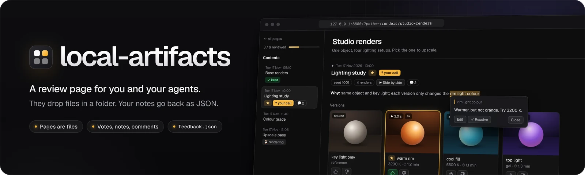
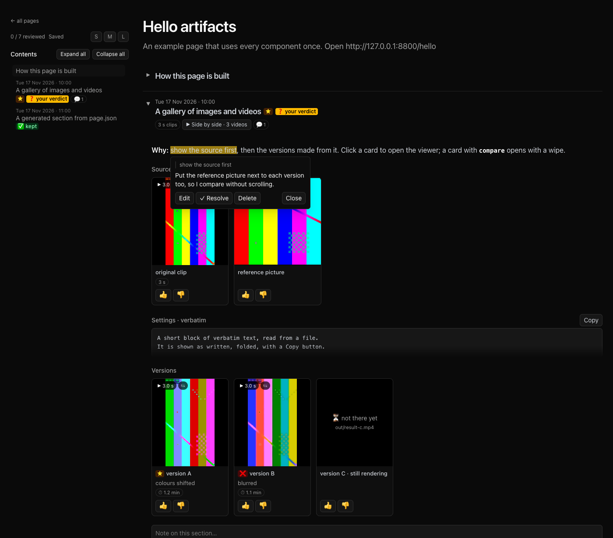

# artifacts

A local board for pages that agents and people write. Drop `page.mdx` (and optionally `page.json`) in a folder next to
your images, videos and text, and artifacts renders it with a contents sidebar, foldable sections, a full-screen viewer,
👍/👎, notes and comments on selected text, all saved to `feedback.json` beside the page for the agent to read.



## Quick start

Needs [Bun](https://bun.sh) and `ffmpeg`/`ffprobe` on the PATH.

```sh
bun install
nohup bun server.ts > /tmp/artifacts.log 2>&1 &   # http://127.0.0.1:8800 lists every page
open http://127.0.0.1:8800/hello                 # the example in examples/hello
```

Pages are found up to 3 levels under `ARTIFACTS_ROOTS` (default `~/Documents:~/Downloads`). Cloned elsewhere? Run
`ARTIFACTS_ROOTS=$PWD:$HOME/Documents bun server.ts` to see the example.

**[AGENTS.md](AGENTS.md)** is the full guide: publishing, components, custom components, contributing, troubleshooting.
